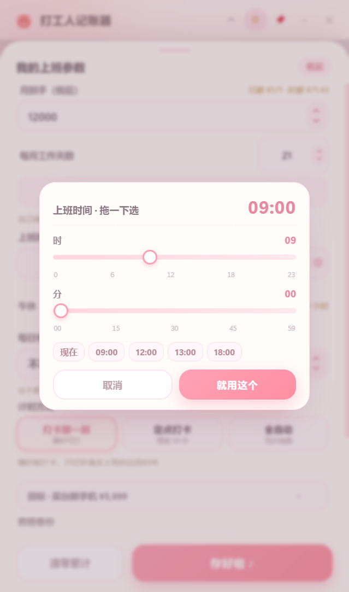

# 打工人记账器 🐷

> 把工资换算成「每秒进账」，看着屏幕上的数字一毛一毛往上跳。
> 一个 424×720 的 Windows 桌面小挂件，喝口水、开个会、熬个夜，都能看见自己赚了多少。

<p>
  
  
  
  
  
  <a href="https://github.com/Fuuiy/dagongren-jizhangqi/releases/latest"></a>
</p>


---

## 这是干什么的

大多数记账 App 记的是「花了多少」，这个记的是「赚了多少」——而且是**每一秒**。

打开就打卡，屏幕上的「今天已经赚了」以 0.02 元的粒度往上跳；一小时能买 25 杯奶茶、够 18 份午饭、换 10 张电影票，全在眼睛底下换算。它不是要你更焦虑，而是把「我今天又白干了」这句口头禅，换成「我这 6 个半小时值 464 块」的实感。

## 功能

**核心**
- **三种计时方式**：打卡那一刻（随时打、只算真实时长）/ 定点打卡（提前 30 分钟提醒）/ 全自动（到点就开跑）
- **薪资换算**：月到手 → 日薪 / 时薪 / 分薪 / 秒薪，四个数字并排；每秒进账按毫秒刷新
- **时间轴**：按**真实打卡**画区间，右边是「预计下班时间」，收工后换成实际收工时刻
- **目标进度**：买台新手机、换个键盘、攒一笔旅行基金，进度条 + 还差多少钱 + 约几个工作日
- **量化消费**：今天的收入 ≈ 25.8 杯奶茶 / 18.6 份午饭 / 10.3 张电影票

**细节**
- **午休暂停**：点「午休一下」暂停计时，回来点「继续」接着算，午休那 1 小时不计入薪水
- **补录与加班**：漏打卡可以事后补；补在班次外的一律算加班，**不封顶**（班内补录才占用日薪额度）
- **请假**：某天请假，当天不计入统计，也不会让「本月已赚」虚高
- **忘下班提醒**：打卡超过班次 4 小时会提示「是不是忘了点下班」
- **明细与历史**：按日、按月看，改过的记录标「补」，删除留痕可撤回
- **小窗模式**：收成一张 424×216 的便签贴在屏幕角落，只留金额，双击横杆展开
- **关闭到托盘**：点 × 不退出，收进右下角通知区继续计时（点图标叫回来，右键才真退出）；也可以在设置里改成「直接退出」
- **首启必须确认**：不填工资就关面板，会先问你「按默认 8,000 开始吗」；用默认值会一直挂提示条
- **切换计时方式先问一句**：会告诉你「今天这 ¥X 会清零」，取消就什么都不变
- **加班倍率**：1 / 1.5 / 2 倍可选（只作用于补录的班外加班）
- **快捷键**：Ctrl+Enter 打卡/下班、Ctrl+B 午休、Ctrl+, 设置
- **小屏自适应**：1366×768@125% 也能一屏放下，打卡按钮永不被裁
- **数据 100% 本地**：存 `localStorage`，支持 JSON 导出/导入备份，连卸载都不会删你的账
- 夜班跨零点、大小周/单休、法定节假日自动算工作日

## 截图

| 上班中 | 收工结算 |
|---|---|
|  |  |

| 参数设置 | 时间滑块 | 小窗模式 |
|---|---|---|
|  |  |  |

## 下载安装

**方式一：安装包（推荐）** — 到本仓库的 [Releases](https://github.com/Fuuiy/dagongren-jizhangqi/releases/latest) 页面下载 `dagongren-jizhangqi-1.0.0-setup.exe`，双击 → 下一步 → 完成。装完桌面和开始菜单都有图标，卸载走 Windows「设置 → 应用」。

- 约 88 MB，只支持 Windows x64
- **不需要管理员权限**，装到当前用户目录，公司电脑也能装
- 首次运行若弹出蓝色 SmartScreen「未知发布者」提示，点「更多信息 → 仍要运行」即可（个人项目没有购买代码签名证书，属正常现象）
- 卸载**保留**记账数据（`%APPDATA%\打工人记账器`）

**方式二：从源码跑**

```bash
git clone https://github.com/Fuuiy/dagongren-jizhangqi.git
cd dagongren-jizhangqi
npm install

# 直接运行
npm start
```

需要 Node.js 18+（推荐 20/22）。首次 `npm install` 会下载 Electron 运行时（约 100 MB）；国内网络慢可以先设镜像：

```bash
npm config set registry https://registry.npmmirror.com
```

## 自己打包安装包

```bash
# Windows x64 → release/打工人记账器-<版本>-安装包.exe
npm run build:win
```

打包配置在 `electron-builder.yml`（NSIS、免管理员、可改安装目录、中文界面、卸载保留数据）。国内网络打包时建议先设环境变量，否则会卡在下载 Electron 压缩包：

```bash
export ELECTRON_MIRROR=https://npmmirror.com/mirrors/electron/
export ELECTRON_BUILDER_BINARIES_MIRROR=https://npmmirror.com/mirrors/electron-builder-binaries/
```

## 数据与隐私

- 所有记账数据只存在本机 `localStorage`，**不登录、不上传、无遥测**
- 唯一的外网请求：启动时拉一次当年法定节假日安排（用于算准每月工作日），失败就降级为「不含节假日」，不影响任何功能
- 导出/导入为 JSON，换电脑直接搬

## 技术栈

纯 Electron + 原生 HTML/CSS/JS，**没有前端框架、没有构建步骤**（改完刷新就见效），一个 120 KB 的 `app.js` 装下全部逻辑。

```
├── main.js              主进程：窗口、单实例、导出/导入、节假日抓取
├── preload.js           极简 IPC 桥（contextIsolation 打开）
├── win-geometry.js      窗口几何规则（正常/小窗尺寸、贴边钳制），主进程与测试共用
├── src/
│   ├── index.html       单页结构（主界面 + 设置面板 + 明细 + 补录 + 时间滑块）
│   ├── style.css        全部样式，粉色主题 + 三段响应式收紧
│   └── app.js           全部逻辑：计时、结算、校验、渲染、存档
├── build/icon.png       应用图标（electron-builder 自动转 ico）
├── electron-builder.yml 打包配置
├── test/                17 个自动化测试套件（见下）
└── docs/                使用说明、需求文档、测试报告、截图
```

**没有引入任何第三方运行时依赖**——`node_modules` 里只有 electron 和 electron-builder 两个开发依赖。

## 测试

这个项目的测试不是摆设：**17 个 Electron 自动化套件、186 条断言**，全部真跑真实渲染进程（不是 mock DOM），包括真实 `execCommand` 键盘编辑、真实点击、真实安装包冒烟。

| 套件 | 覆盖 | 断言 |
|---|---|---|
| `run-p0.js` | 核心链路：打卡 → 午休 → 下班 → 结算 | 13 |
| `run-p1.js` | 全功能回归：三种模式、请假、补录、明细、小窗 | 29 |
| `run-boundary.js` | 边界：0/负数/超长输入、跨零点、极限工时 | 29 |
| `run-inputs.js` | 输入交互：时间掩码、光标定位、滑块、数字箭头 | 19 |
| `run-overtime.js` | 补录加班：班内/班外拆分、不封顶、防重复领 | 13 |
| `run-exe-smoke.js` | 打包版冒烟：首启 → 打卡 → 持久化 → 单实例 → 托盘 | 11 |
| `run-window.js` | 窗口形态：小窗往返、小屏自适应、几何漂移 | 14 |
| `run-mode-reset.js` | 切换计时方式：金额归零、不替你打卡、补录保留 | 12 |
| `run-tray.js` | 托盘：点 × 只隐藏、图标开关、退出路径 | 7 |
| `run-firstrun.js` | 首启校验、清零确认、倍率、关闭行为、快捷键、数据路径 | 15 |
| `run-network.js` | 网络异常：节假日接口超时/500/坏 JSON 降级 | 9 |
| `run-compat.js` | 兼容：缩放、DPI、极端分辨率 | 8 |
| `run-v111.js` | 新控件：时间滑块、粉色数字箭头 | 8 |
| `run-defects.js` | 历史缺陷回归（7 个真 bug 的钉子） | 7 |
| `run-coverage.js` | 白盒覆盖率采集（当前行覆盖 ~95%） | — |
| `run-perf.js` / `run-startup.js` | 长驻内存、冷启动耗时 | — |

```bash
# 单套件（在仓库根目录）
npx electron test/run-p0.js

# 打包版冒烟需要先 npm run build:win 或指向已安装目录
WB_EXE_PATH="C:/Users/you/AppData/Local/Programs/打工人记账器/打工人记账器.exe" node test/run-exe-smoke.js
```

> 测试里抓出过的真 bug 举例：切模式时按新配置判断导致「白送一天工资」、时间输入中间删改跳成 `10:05`、金额清空后箭头 1→101→201、小窗展开后永远满屏。都留在 `run-defects.js` 做回归钉子。

## 常见问题

**Q：数字对不上我的工资？**
月到手填的是「扣完五险一金和个税后到卡里的钱」，日薪 = 月到手 ÷ 每月工作天数。想更细可以填「每日有效工时」（比如实际每天只干 7 小时）。

**Q：能拖动窗口改大小吗？**
不能。窗口只有「完整」和「小窗」两种形态，由底部横杆切换——这样卡片永远不会被裁掉，也不需要滚动条。

**Q：换电脑数据怎么搬？**
设置 → 数据备份 → 导出数据，得到 JSON；新电脑点导入。

**Q：点了 × 程序怎么不见了？**

它是收到 Windows 右下角通知区（托盘）了，计时一秒没停。点那个小图标就能叫回来；右键图标 → 退出打工人记账器 才是真退出。找不到图标就点一下任务栏的 `^`。

**Q：我切了计时方式，今天的钱怎么变 0 了？**

三种方式算钱口径不同（打卡按实际时长、全自动按班次），混着算会算错，所以**切完就从 0 重新开始**，而且要你自己点打卡——程序不会替你上班。手动「补录」的钱不受影响。只改工资、上班时间不会清零。

**Q：为什么每秒进账显示 4 位小数？**
月薪 12000、21 个工作日时，秒薪约 0.0198 元。四位小数才看得出它在动。

## 版本

- **v1.0.0** — 首个对外版本（内部迭代到 1.11 后统一归为 1.0.0）

## License

[MIT](LICENSE) © 2026 Fuuiy

---

<p align="center"><sub>每一秒都算数 ♡</sub></p>
